# DOK 4 — Adım Adım Geliştirme ve Log-Kapılı Doğrulama Planı (Paket 4B.4)

> **Belge Zinciri:**
> [DOK 1: Hedef ve Gereksinimler](DOK1_HEDEF_VE_GEREKSINIMLER.md) |
> [DOK 2: Mevcut Kod Debug, Akış Şeması ve Gerçek Log Sapma Raporu](DOK2_MEVCUT_KOD_DEBUG_VE_AKIS_RAPORU.md) |
> [DOK 3: Endüstri Araştırması ve Olması Gereken İdeal Akış Şeması](DOK3_ENDUSTRI_VE_BENZER_PROJELER_ARASTIRMASI.md) |
> **[DOK 4: Adım Adım Geliştirme Planı](DOK4_ADIM_ADIM_GELISTIRME_PLANI.md)**

---

## 1. Çalışma Kuralı: Tek Tek Faz, Log Kapısı ve PlayMode Onayı

Bu planda **tüm sorunlar aynı anda karıştırılmayacaktır**. Her alt faz (`4B.4-A .. 4B.4-E`) yalnızca tek bir problem grubunu hedefler ve bir sonraki faza geçmeden önce şu **3 kapıyı** geçer:
1. **`FluidDeepDiagnosticProbe` Log Kapısı:** İlgili senaryodaki (`S1..S6`) gerçek log değerlerinin [`DOK 1` Bölüm 4](DOK1_HEDEF_VE_GEREKSINIMLER.md#4-6-te%C5%9Fhis-senaryosu-i%C3%A7in-beklenen-de%C4%9Ferler-matrisi-expected-values--invariants) Beklenen Değerler tablosuna tam oturması.
2. **Regresyon Kapısı:** `.NET 10` (`>= 226/226 PASS`, `0 Warning / 0 Error`), Unity 6 `recompile --strict` + `EditMode` PASS.
3. **Kullanıcı Canlı PlayMode Onayı:** Kullanıcı oyunda tek o adımı gözüyle test edip onayladıktan sonra sonraki faza geçilir.

```mermaid
flowchart LR
    P0["TAMAMLANDI:\nEnstrümantasyon + S1..S6 Baseline Log\n+ DOK1..DOK4"] --> FA["Faz 4B.4-A (P1 & P2)\nBekleme/Starvation &\nYavaş Akış Çözümü"]
    FA -->|"S1, S2, S4 Log PASS\n+ PlayMode Onayı"| FB["Faz 4B.4-B (P3)\nTek Gerçek SurfaceNets Zemin &\nBaloncuk/Gömülme Çözümü"]
    FB -->|"S1, S3 Mesher Log PASS\n+ PlayMode Onayı"| FC["Faz 4B.4-C (P4)\nSu+Lav Obsidyen Crest &\nSıfır Fermuar/Z-Fighting"]
    FC -->|"S5 Log PASS\n+ PlayMode Onayı"| FD["Faz 4B.4-D (P5)\nShader Faset, Akış Kapısı,\nGölge & Kıyı Alpha"]
    FD -->|"Shader & PlayMode Onayı"| FE["Faz 4B.4-E (P6)\nToprak Emilimi Dengesi &\nArka Plan Mesh Güvenliği"]
    FE --> QG["quality-gate.ps1 -Phase 4\n+ Devir #070 Kapanış"]
```



---

## 2. Faz 4B.4-A — Dökülen Suyun Beklemesi (`P1`) ve Aşırı Yavaş Akması (`P2`) Çözümü *(İLK UYGULANACAK)*

**Referanslar:** `DOK 1` (`AK-1..AK-6`), `DOK 2` (`S4: 32/32 starved`, `S1: MaskEarlyExitNoWet, NotGrounded=6, SlopeRoutingStarved=367, ZeroShare=101, slopeSum=861, DiagChangedMaskSkip=2082, upslopeDy1=6`), `DOK 3` (İlke 1 & İlke 2).

### Değişecek Dosyalar ve Somut Kod Değişiklikleri
1. **[`Assets/_Stratocraft/Character/Stage1InteractivePlayController.cs`](../../Assets/_Stratocraft/Character/Stage1InteractivePlayController.cs)** (`StepFluidSimulation` `L1934-1975` & `RebuildAllDirtyChunks` `L5113`):
   - **3-Kademeli Açlıksız Seçim:**
     * Önce `dist <= 1` (`3×3 = 9` oyuncu chunk'ı) **koşulsuz** `_activeFluidScratch`'e eklenir (`budgetChunks` tavanı en az `Math.Max(budgetChunks, nearCoreCount)`).
     * Sonra `dist == 2..4` chunk'ları `dist` sırasıyla ve `_fluidNearRoundRobinCursor` ile dairesel seçilir -> **`WatchChunkStepped == true` (`32/32`), `NearStarvedCount` sabit kalmaz**.
   - `ExchangeChunkBorderFluids` sonrası: `seamTransfers > 0` ise su alan her komşu chunk'ın `_fluidSystem.InvalidateChunkActivityMask` + `_activeFluidChunks.Add` garantisi (`_dirtyFluidChunks` dışına kaçan sınır komşusu kalmaz).
   - `RebuildAllDirtyChunks` (`L5113`): `_dirtyChunks.Contains(key)` nedeniyle fluid remesh'i erteleme kaldırılır (yalnızca `_inFlightDistantMeshKeys.Contains(key)` korunur).
2. **[`Assets/_Stratocraft/Physics/Data/FluidPorosityUtility.cs`](../../Assets/_Stratocraft/Physics/Data/FluidPorosityUtility.cs)** (`TryResolveFluidPourCell` `L195-215`, `ApplyContainerFluidPour` `L479-505`):
   - `TryResolveFluidPourCell`: Dar-bant SDF hava hücresi (`aimDens >= 24`) üzerine doğrudan dökme yerine, yamaç üstünde (`hitNormalY >= 0.25f`) `aimY + 1` serbest hava hücresini tercih et (yarı-gömülü başlangıç biter).
   - `ApplyContainerFluidPour` 2. aşama (`L495`): `targetY > layerY` (yokuş yukarı `y+1`) ve `nBed > centerBed + 64` olan komşulara yazmayı engelle (`upslopeDy1 == 0`).
3. **[`Assets/_Stratocraft/Physics/Jobs/FluidCellularAutomataJob.cs`](../../Assets/_Stratocraft/Physics/Jobs/FluidCellularAutomataJob.cs)**:
   - **Dış Yazma Maske Koruması (`L204`):** `ExchangeChunkBorderFluids` içine opsiyonel/otomatik `activityMask` invalidation + çağırıcı kontratı; `StepFluidGridVolumeConservative` `canUseFastMask` iken `activityMask.IsInitialized == 0` olduğunda tam tarama yapar.
   - **Yukarıdan-Aşağıya `RunLateralPairPass` (`L1541`):** `for (int y = clampedEndY; y >= clampedStartY; y--)` -> üst katman (`y+1, y+2`) değerlendirilirken alt katman hâlâ `255` doludur -> **`NotGrounded == 0`**, dev kazan kulesi 1. tikte yanlara çöker!
   - **Bölge-Doğru Eğim (`ComputeStableLateralTransfer` `L2528-2535` & `ExecuteInChunkCrossLayerTransfer` `L1944-1946`):**
     ```csharp
     int srcSlope223 = (srcCap == 255 && srcMass > 32 && bedSrc > (y - 1) * 255 && bedSrc < y * 255)
         ? Math.Max(223, (y + 1) * 255 - (bedSrc + 32))
         : 223;
     int dstSlope223 = (dstCap == 255 && dstMass >= 32 && bedDst > (y - 1) * 255 && bedDst < y * 255)
         ? Math.Max(223, (y + 1) * 255 - (bedDst + 32))
         : 223;
     ```
     Kuru hedef ve `<= 32` doğrusal bölgede **`%50` yapay fren tamamen kalkar!**
   - **`EvaluateDonorSlopeRouting` Sadeleştirme (`L2085, 2123, 2152, 2220`):**
     * `nCap - nMass < 4` olan neredeyse dolu komşuları ele (ağırlık çalması biter).
     * `srcMass < 135 -> slopeShare256 = 0` sert sıfırlamasını kaldır (en az `64/256` akış payı bırak; yalnız dik uçurumda `maxFreeOverfallDrop > 160` ve `targetMass == 0` iken kısıtla).
     * `ComputeStableLateralTransfer`'da `slopeShare256` yalnızca `rawPipe` üzerinde uygulansın (çifte bölünme kalkar).
   - **`RunDiagonalSteepSlopeEscapePass` (`L2391, 2472`):** `changedMask[idx] != 0` yerine `(changedMask[idx] & 0x1E) != 0` (sadece yeni-ıslak / diyagonal kilidi) ve `MarkChanged3x3Horizontal` yerine `MarkChangedWithNeighbors` (kaynak + hedef) -> **`Pass 2.5` yeniden hayata döner!**
   - **`QuiescentTicks` Güvenliği (`L564`):** `anyDownhillDrain` yalnızca `bedDrop > 8` değil `bedDrop > 2` (hafif eğim dahil!) için de `true` sayılır -> eğimde erken zorunlu uyku olmaz.

### Faz 4B.4-A Doğrulama Kapısı
- `S4`: `Watch(0,0)` `Starved == 0 / 32`.
- `S1`: `upslopeDy1 == 0`, `NotGrounded == 0`, `T=8 centroidDx >= 5.5 m`, `T=16 centerCol <= 20 Br`, `chunk[1,0]` `MaskEarlyExitNoWet == 0`, `P25_Diag > 0`.
- `S2`: `T=16 centroidDx >= 4.0 m`, `ForcedQuiescent == 0`.
- `S7` (`Seed 1453 Chunk -6,-9`) & `S9` (`Chunk -4,-6`): `NotGrounded == 0`, `SlopeRoutingStarved` / `ZeroShare` dramatik düşüş, `S9` `centerCol` hızla boşalır.
- `S8` (`Seed 1453 Chunk -7,-4` gölet ortası delik boşaltması): `NotGrounded == 0`, çok-bloklu dikey serbest düşüş (`Pass 1` hızlandırılmış yerçekimi / kilit temizliği) ile 80 tik boşaltma oranı `%15.1 -> >= %45+` (gölet yüzeyi gözle görülür biçimde iner!).
- `S3` + mevcut `220/220` test: `0` regresyon (`T01..T16` & `T01..T28` tam PASS).

---

## 3. Faz 4B.4-B — Tek Gerçek `SurfaceNets` Zemin & Baloncuk / Gömülme Çözümü (`P3`)

**Referanslar:** `DOK 1` (`AK-7..AK-9`), `DOK 2` (`S1: MaxSurfMinusTrueSn=+1.734m, MaxTopSlope=65.0deg, MinSurfMinusTrueSn=-0.278m, MaxBedVsSnDiff=0.700m, DryVirtBank=44, ConcaveHoles=4`), `DOK 3` (İlke 3).

### Değişecek Dosyalar ve Somut Kod Değişiklikleri
1. **[`Assets/_Stratocraft/Voxel/Data/FluidHydrostaticsShared.cs`](../../Assets/_Stratocraft/Voxel/Data/FluidHydrostaticsShared.cs)** (`ComputeCellBedElevationUnits255` `L140-158`):
   - `dCurr == 0` dalındaki hatalı `((dBelow - 64) * 255 + 30) / 60` (`+0.504 m` şişirme!) yerine gerçek `SurfaceNets` izo-yüzeyiyle birebir eşleşen formüle geç:
     ```csharp
     int denom = Math.Max(1, dBelow - dCurr);
     int isoOffset255 = Math.Clamp(((dBelow - StratocraftConstants.SdfIsoLevel) * 255) / denom, 12, 243);
     ```
     (`dBelow=127, dCurr=0 -> isoOffset255 = 126` = `y - 0.506 m` -> gerçek `HybridSurfaceNetsAndShapeMesher` ile **`<= 0.004 m` eşlik**!).
   - Yeni paylaşılan yardımcı: `ComputeTrueSurfaceNetsCornerElevationMeters(...)` (4 köşe sütununda `dBelow` + `dCurr` simetrik ortalaması; `+X/+Z` asimetrisi yok!).
2. **[`Assets/_Stratocraft/Voxel/Jobs/FluidSurfaceSkirtMesher.cs`](../../Assets/_Stratocraft/Voxel/Jobs/FluidSurfaceSkirtMesher.cs)**:
   - `EvaluateSurfaceNetsTerrainYAtCorner` ve `SampleTrueSurfaceNetsFloorYAtCorner` içindeki `dCurr` körlüğünü ve `0.496` kilidini kaldır; `FluidHydrostaticsShared.ComputeTrueSurfaceNetsCornerElevationMeters` çağır -> **`MaxBedVsSnDiff <= 0.05 m`!**
   - `EvaluateRichCornerFast`: 6 sert rejim arasındaki kopuk sıçramaları tek sürekli `smoothstep` kalınlık/kenar eğrisine bağla; tüm açık kenarlarda `avgCurrSurfY >= trueSnCornerY + 0.015f` alt sınırı garantile (**`MinSurfMinusTrueSn >= -0.02 m`**, **`MaxSurfMinusTrueSn <= 1.05 m`**, **`MaxTopSlopeDeg <= 35°`**).
   - `pendingDryBedY` artık aynı gerçek `b_true` ölçeğini okuduğu için **`DryVirtBank == 0`**.
   - `EmitSingleConcaveBridgeTriangle` ile `EmitRichSideOrWaterfallCurtain` aynı `CanEmitConcaveBridge(...)` (SkirtOffset dahil!) kontrolünü paylaşır -> **`ConcaveHoles == 0`**.
   - `GetOrComputeSharedCornerNormal` komşuları `canonicalY` + `y±2` destekli sorgular -> **`CrossLayerNormalDiscrepancyCount == 0`**.

### Faz 4B.4-B Doğrulama Kapısı
- `S1`: `MaxBedVsSnDiff <= 0.05 m`, `MinSurfMinusTrueSn >= -0.02 m`, `MaxSurfMinusTrueSn <= 1.05 m`, `MaxTopSlopeDeg <= 35°`, `ConcaveHoles == 0`, `DryVirtBank == 0`, `InvTri == 0`.
- `S7` (`Chunk -6,-9` dağ taşması) & `S9` (`Chunk -4,-6` yamaç kubbesi): **`flatCapTris == 0`** (Görsel 10'daki tepedeki `1×1m` parlak turkuaz kare yok!), `DryVirtBank == 0` (`119 -> 0`), `MinSurfMinusTrueSn >= -0.02 m` (Görsel 5'teki `-1.12 m` buz altına gömülme yok!), `MaxTopSlopeDeg <= 38°` (`68.8° -> <= 38°`).
- `S8` (`Chunk -7,-4` kuyu içi): Kuyu duvarı sivri dikenleri (`MaxBedVsSnDiff 3.225m -> <= 0.05m`, `ConcaveHoles 2 -> 0`).
- `S3`: `MaxTopSlopeDeg <= 1.0°`, `MaxBedVsSnDiff <= 0.05 m`.
- Kullanıcı PlayMode'da buzlu/karlı yamaçta Dev Kazan dökümünü onaylar.

---

## 4. Faz 4B.4-C — Su + Lav Obsidyen Seti & Sıfır Fermuar (`P4`)

**Referanslar:** `DOK 1` (`AK-10..AK-11`), `DOK 2` (`S5: 5/5 CrestBlockedBySdfAir, 30 Steam / -10.850 Br kayıp, OppCoplanar=18, MaxSkirt=0.800m`), `DOK 3` (İlke 4).

### Değişecek Dosyalar ve Somut Kod Değişiklikleri
1. **[`Assets/_Stratocraft/Physics/Jobs/FluidCellularAutomataJob.cs`](../../Assets/_Stratocraft/Physics/Jobs/FluidCellularAutomataJob.cs)**:
   - `TryStampSurfaceObsidianCrest` (`L2976`): `voxels[aboveIdx] != 0u` yerine `VoxelBitUtility.IsPhysicallySolid(voxels[aboveIdx])` -> dar-bant SDF hava hücresinde crest `%100` yazılır (`CrestBlockedBySdfAir == 0`).
   - Hazne çekimi öncesi/sonrası `hasFullSurfaceOnNaturalBed` kontrolü düzeltilir; crest yoğunluğu `84 -> 116` (`~0.45 m` gerçek kalınlık) yapılır; `obsidianFormedCount` ve `ExecuteSeamCrossLayerTransfer` hız temizliği tamamlanır.
2. **[`Assets/_Stratocraft/Voxel/Jobs/FluidSurfaceSkirtMesher.cs`](../../Assets/_Stratocraft/Voxel/Jobs/FluidSurfaceSkirtMesher.cs)**:
   - `isThinOrOppositeFluidBank` araması `y` yanında `y±1`'i de tarar ve karşıt sıvı destekli tek-voksel duvarda etek uzatmasını `<= 0.28 m` (obsidyen yarım-kalınlığının içi!) sınırlar.
   - `EmitRichSideOrWaterfallCurtain`: Karşıt sıvı ile doğrudan temas kenarında coplanar çift duvar çizilmesini önler (`OppCoplanar == 0`).
3. **[`Assets/_Stratocraft/Character/Stage1MatterCrystalAndMiningController.cs`](../../Assets/_Stratocraft/Character/Stage1MatterCrystalAndMiningController.cs)** (`L942`):
   - Döküm anı obsidyeni de CA ile tutarlı olarak `ShapeId = 0` (`NaturalObsidian`) üretir.

### Faz 4B.4-C Doğrulama Kapısı
- `S5`: `CrestBlockedBySdfAir == 0`, `T >= 2` sonrası `Steam == 0`, `OppCoplanar == 0`, Su/Lav etek örtüşmesi `0`.
- Kullanıcı PlayMode'da okyanus/lav sınırını onaylar.

---

## 5. Faz 4B.4-D — Shader Faset, Yamaç Akışı, Gölge & Kıyı Alpha (`P5`)

**Referanslar:** `DOK 1` (`AK-12`), `DOK 2` (Mesher/Shader denetim raporu), `DOK 3` (İlke 5).

### Değişecek Dosyalar ve Somut Kod Değişiklikleri
1. **[`Assets/_Stratocraft/Voxel/Jobs/FluidSurfaceSkirtMesher.cs`](../../Assets/_Stratocraft/Voxel/Jobs/FluidSurfaceSkirtMesher.cs)**:
   - Tüm yan etek ve şelale üst köşelerinde `WaterfallFoam01 + 2.0f` (`seamLockedTopVertex`) kodlanır -> alt-tik ve dalgada üst yüzey / yan duvar yırtılması `%0`.
2. **[`Assets/_Stratocraft/Rendering/Shaders/StratocraftFluidSurface.shader`](../../Assets/_Stratocraft/Rendering/Shaders/StratocraftFluidSurface.shader)**:
   - Ölü `stillness01` kaldırılır; `activeMotionGate` yamaç eğimini (`slopeSin > 0.12`) de dahil ederek hareketli derede donuk/yamalı bölgeleri yok eder.
   - `upwardMask` ve `sideWallMask` `faceNormalWS` yerine `geomNormalWS` tabanlı yapılır (üçgen faset kırıkları biter).
   - `TransformWorldToShadowCoord` + `GetMainLight(shadowCoord)` ile gerçek arazi/dağ gölgeleri eklenir.
   - Kıyı kenarı alpha'sı `depthMeters -> 0` iken gerçek `0.0`'a yumuşak iner (kar/buz üstünde sert mavi çerçeve biter).
   - Lav kabuğu için `spatialJitter` eklenir.

---

## 6. Faz 4B.4-E — Toprak Emilimi Dengesi & Eşzamanlılık Hijyeni (`P6`)

**Referanslar:** `DOK 1` (`AK-13..AK-14`), `DOK 2` (`S6: %99.1 soil absorption in 2s`, `StartBackgroundDistantMeshBatch` race condition).

### Değişecek Dosyalar ve Somut Kod Değişiklikleri
1. **[`Assets/_Stratocraft/Physics/Systems/SoilMoistureAndMudSystem.cs`](../../Assets/_Stratocraft/Physics/Systems/SoilMoistureAndMudSystem.cs)**:
   - `StepChunkSoilInfiltration` emilim hızı ve kolon başına çekim kalibre edilerek `S6` 2 sn emilimi `%10..%30` bandına getirilir (su toprakta görünür akarken gerçekçi hızla emilir).
2. **[`Assets/_Stratocraft/Character/Stage1InteractivePlayController.cs`](../../Assets/_Stratocraft/Character/Stage1InteractivePlayController.cs)**:
   - `StartBackgroundDistantMeshBatch` (`L4784`) canlı `_fluidChunks` dizilerini referans olarak vermek yerine havuzlu kopya (snapshot) verir -> 0 veri yarışı (`race condition`).
   - `SnowAccumulationAndMeltSystem` (`L504` ve `OnColumnVoxelEdited`) & `WaterCycleAndEvaporationSystem` (`chebDist > 5`) eksik `activityMask` / `_dirtyFluidChunks` bildirimleri tamamlanır.
3. **[`Assets/_Stratocraft/Physics/Jobs/FluidBurstSurfaceScanUtility.cs`](../../Assets/_Stratocraft/Physics/Jobs/FluidBurstSurfaceScanUtility.cs)**:
   - Burst hash formülü `ChunkFluidActivityMask.AccumulateWordHash` ile birebir eşitlenir.

---

## 7. Son Kalite Kapısı (Tüm Fazlar Onaylandıktan Sonra)
- `powershell -ExecutionPolicy Bypass -File scripts/quality-gate.ps1 -Phase 4` (`0 Error / 0 Warning`, `< 16 MB` VRAM, `0` eksik `.meta`, `0` mutlak yol).
- `docs/test-raporlari/faz4b4-raporu.md` + `DURUM_VE_DEVIR.md` güncellemesi.
